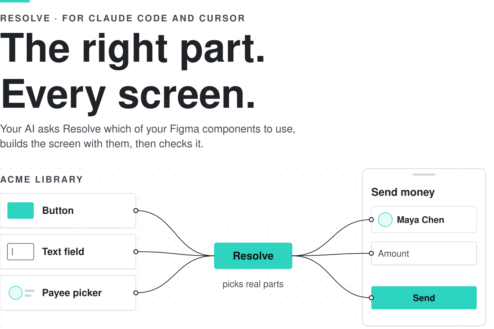
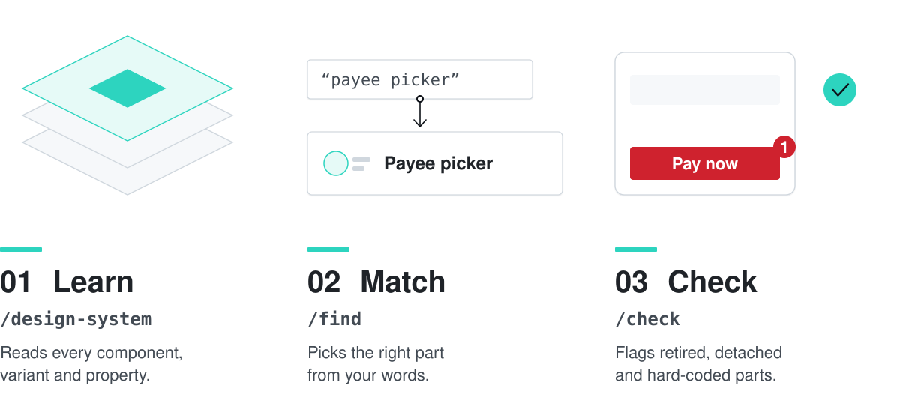
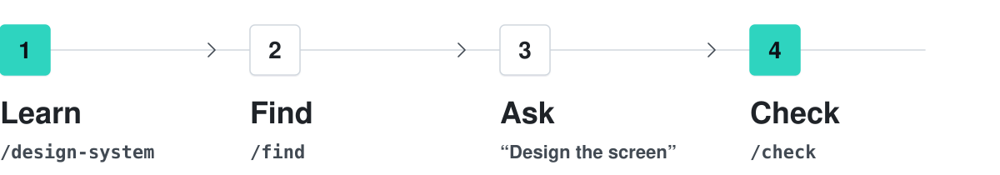
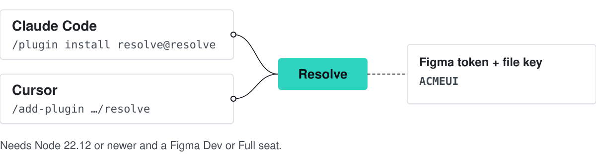
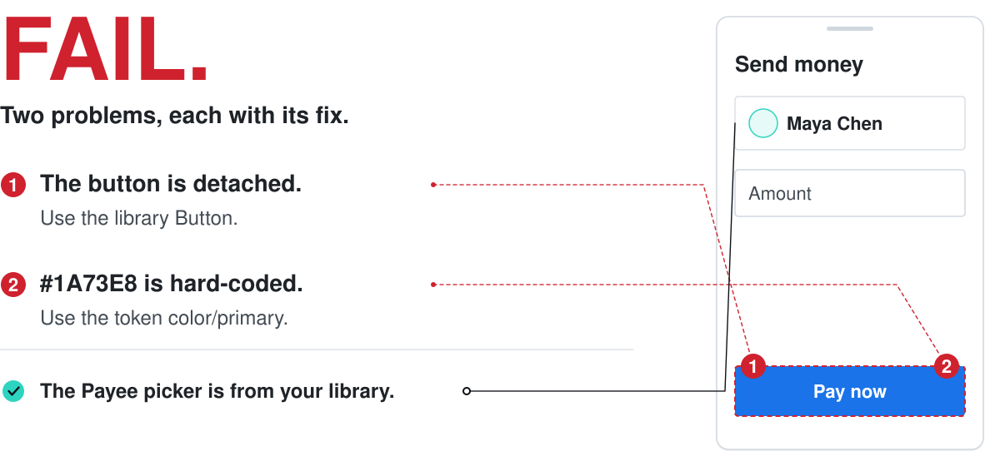
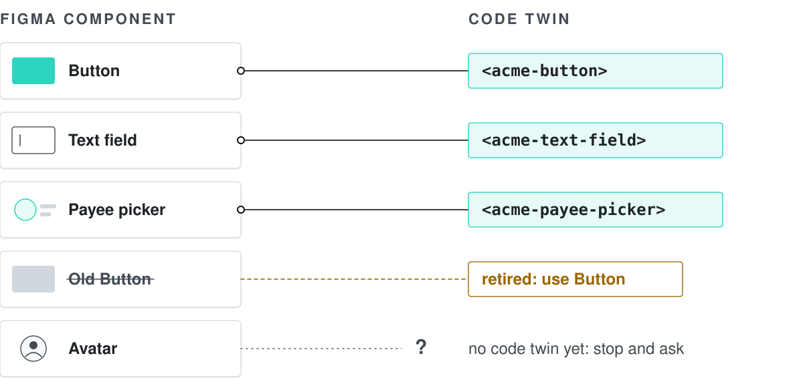
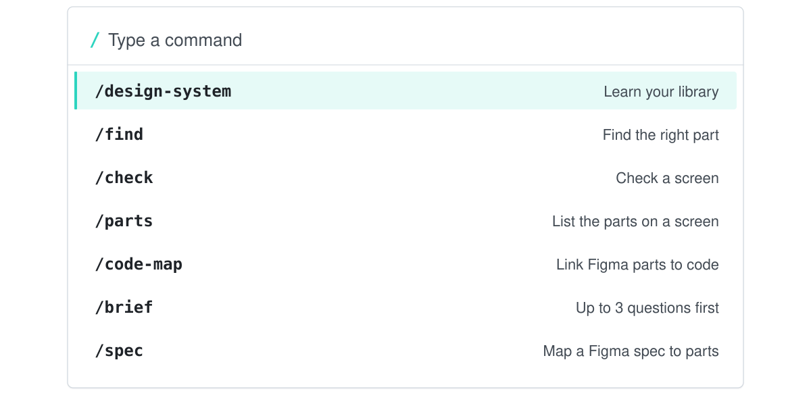

<p align="center"><picture><source media="(prefers-color-scheme: dark)" srcset="docs/assets/resolve-logo-dark.svg"></picture></p>

<picture><source media="(prefers-color-scheme: dark)" srcset="docs/assets/v4/hero-dark.svg"></picture>

<p align="center"><a href="#quick-start"><b>Quick start</b></a> · <a href="#install">Install</a> · <a href="INSTALL-FOR-AI.md">Install for AI</a> · <a href="docs/REFERENCE.md">Full reference</a></p>

<p align="center">
	<a href="https://github.com/TANISHQBAFNA/resolve/actions/workflows/ci.yml"></a>
	<a href="LICENSE"></a>
	<a href="package.json"></a>
	<a href="package.json"></a>
	<a href=".claude-plugin/plugin.json"></a>
	<a href=".cursor-plugin/plugin.json"></a>
</p>

## What it does

<picture><source media="(prefers-color-scheme: dark)" srcset="docs/assets/v4/what-dark.svg"></picture>

Resolve gives your AI two things about your design system: **what your components are** (variants, properties, real examples and code) and **how to use them** (a short always-on rule and screen recipes). Your AI asks Resolve before it draws. Resolve only reads. It never draws and never changes your Figma file.

> [!NOTE]
> The pictures use **Acme**, a made-up design system. They are illustrations, not screenshots.

## Quick start

<picture><source media="(prefers-color-scheme: dark)" srcset="docs/assets/v4/quick-dark.svg"></picture>

1. **Learn your library.** Paste the link to your design system file.

   ```
   /design-system https://www.figma.com/design/ACMEUI/Acme
   ```

   You see how many components it learned, how many are retired, and where it saved them.

2. **Find a part.** Use its name if you know it, or your own words.

   ```
   /find payee picker
   ```

   ```text
   name: Payee picker | figmaNodeId: 30:30 | fileKey: ACMEUI | why: used 4× in file | ex: 20:31
   ```

3. **Choose and configure.** For a screen, ask for the real component and only the properties the library allows.

   ```
   /configure primary button on a sign-in screen
   ```

   Resolve returns one component, the values it could set, and a warning where it could not verify a property. It does not invent a component.

4. **Check it.** Paste the link to that one screen.

   ```
   /check https://www.figma.com/design/ACMEUI/Acme?node-id=20-40
   ```

   ```text
   FAIL
   deprecated:
     - name: Old Button | figmaNodeId: 30:50 | fileKey: ACMEUI | status: deprecated
   ```

   The Acme Send money screen still uses the retired Old Button, so it fails. Swap it for Button and check again.

The output lines are shortened from real runs on the Acme example library.

## Install

<picture><source media="(prefers-color-scheme: dark)" srcset="docs/assets/v4/install-dark.svg"></picture>

You need Node 22.12 or newer, Claude Code or Cursor, and a Figma Dev or Full seat.

**Claude Code.** Type these two lines in the chat:

```
/plugin marketplace add TANISHQBAFNA/resolve
```

```
/plugin install resolve@resolve
```

**Cursor.** Type this in the chat, then install **resolve**:

```
/add-plugin https://github.com/TANISHQBAFNA/resolve
```

Then fill in your **Figma token** and the **library file key**. For the code workflow, set **Workflow mode** and **Code repo folder** instead (or as well). The key is the id in the file link: in `figma.com/design/ACMEUI/Acme` it is `ACMEUI`. Never put the token in a file.

**Or let your AI install it in one project.** Paste this into the chat:

> Install Resolve from https://github.com/TANISHQBAFNA/resolve — follow INSTALL-FOR-AI.md

The version badge is the last published tag, `0.2.0`. That tag does not include `/configure`, the `resolve-configure` skill, or screen map. To try this revision, check out the repository, run `npm run build:server`, then in a scratch project run `node /absolute/path/to/resolve/bin/resolve-setup.mjs`. That writes this checkout's built server. Do not install `github:TANISHQBAFNA/resolve#v0.2.0` and expect those commands.

**Grok Bot, Codex and other MCP agents.** Resolve is a standard MCP server, so any agent that can add one can use it. Steps for Grok Bot and Codex are in [INSTALL-FOR-AI.md](INSTALL-FOR-AI.md).

Claude Desktop and by-hand steps: [Install in detail](docs/REFERENCE.md#install-in-detail).

## Check a screen

<picture><source media="(prefers-color-scheme: dark)" srcset="docs/assets/v4/check-dark.svg"></picture>

Every problem comes with its fix. Retired parts, detached parts, hard-coded values, wrong property values and accessibility are all checked.

## From design to code

<picture><source media="(prefers-color-scheme: dark)" srcset="docs/assets/v4/code-dark.svg"></picture>

The code map says which Figma part is which code part. Resolve can read your component package and suggest pairs. A suggestion is not the truth: someone confirms it. Only a confirmed pair shows on `/parts`. If a part has no confirmed pair, stop and ask. Details: [Code map in the reference](docs/REFERENCE.md#scan-suggest-review).

## Figma or code

One engine, two workflows. Your words pick the workflow: "design this in Figma" uses the Figma part, "build an HTML prototype" uses the code part. Only that part's rules and tools load. If your words do not say, Resolve uses `mode` in `.resolve/config.json`, and if that is not set it asks one short question.

```json
{ "mode": "code", "repoPath": "../design-system", "cssEntry": "css/ds.css", "theme": "theme/tokens.css" }
```

`mode` is `figma`, `code` or `both` (override with `RESOLVE_MODE`; `RESOLVE_REPO_PATH`, `RESOLVE_CSS_ENTRY` and `RESOLVE_THEME` override the rest). With no `mode`, a set `repoPath` means `both`, otherwise `figma`, so existing installs behave as before.

The code workflow reads a repo of HTML/CSS and builds a catalog of its real components (classes, variants, markup, deprecated classes, tokens). `/learn-code` builds it, `/pick-code` picks parts, `/check-html` checks a screen. The same steps run in a shell: `resolve code scan`, `resolve code pick "<need>"`, `resolve code check <file.html>`. `resolve mode` shows what is active. Resolve only reads the repo.

## Using Resolve in CI

Resolve never stops on a finding. Every problem is a warning with a `next:` step, and the command exits 0, so a designer or an AI tool can keep going. A CI job wants the opposite, so add `--strict` to each check. With `--strict`, a finding gives its non-zero exit code and the job fails.

A checkout of this repository runs the same checks with `node bin/resolve-cli.mjs` from that checkout. The block below is the last published tag, `0.2.0`. That tag does not include `/configure`.

```yaml
# GitHub Actions step for the published tag (Node 22 or newer). Not this checkout.
- name: Check screens with Resolve
  run: |
    npx -y -p github:TANISHQBAFNA/resolve#v0.2.0 resolve-figma verify "Send money" --strict
    npx -y -p github:TANISHQBAFNA/resolve#v0.2.0 resolve-figma code check prototype/index.html --strict
    npx -y -p github:TANISHQBAFNA/resolve#v0.2.0 resolve-figma brief check briefs/send-money.md --strict
```

- Flag names ignore case, and `--strict=true` works too. `--strict=false` turns it off.
- A misspelled flag (for example `--stirct`) is not silently dropped: Resolve prints `warning: unknown flag` with a `did you mean` hint. Read the job log, or fail on that line if you want to be sure.
- Without `--strict` the same commands exit 0, so a job without it will always pass.
- Exit codes per command: [Every command](docs/REFERENCE.md#every-command).

## Commands

<picture><source media="(prefers-color-scheme: dark)" srcset="docs/assets/v4/commands-dark.svg"></picture>

| Type | You get |
| --- | --- |
| `/design-system <link>` | Resolve learns that Figma file and saves its components. |
| `/find <phrase>` | The right component, a weak match marked as weak, or "no match". |
| `/check <link>` | Pass, or the retired, wrong and unknown parts plus proper-use problems. |
| `/parts <link>` | Each component on the screen and its mapped code twin. Unmapped means stop and ask. |
| `/brief` | Asks up to 3 quick questions before Resolve picks parts. |
| `/code-map` | One command: the import map, package scan/suggest/review, and coded joins (`--pairs`, `--unmatched`, `--suggest`). |
| `/spec <link>` | Reads a Figma spec and maps each screen requirement to a real component, or says no match. |
| `/learn-code [folder]` | Code workflow. Reads the repo and learns its real classes, variants and tokens. |
| `/pick-code <need>` | Code workflow. The right coded component, with its classes and markup. |
| `/check-html <file>` | Code workflow. Unknown or deprecated classes, missing base classes, hard-coded values. |
| `/resolve-status` | What is learned, whether the token and rule are set, and what to do next. |
| `/map` | Opt-in. Walk an Acme screen tree: outline, one screen, a node, a journey, or drift. Warnings only. |

## Learn more

| Topic | Where |
| --- | --- |
| A brief before the screens | [Design brief](docs/design-brief.md) |
| A private screen tree | [Screen Map](docs/screen-map.md) |
| A prototype before developers | [Prototype readiness](docs/readiness.md) |
| How it works, step by step | [How it works in detail](docs/REFERENCE.md#how-it-works-in-detail) |
| Proper-use checks | [Check that a screen uses the library properly](docs/REFERENCE.md#check-that-a-screen-uses-the-library-properly) |
| Accuracy and the phrase scoreboard | [Accuracy and honesty rules](docs/REFERENCE.md#accuracy-and-honesty-rules) |
| Every command and option | [Every command](docs/REFERENCE.md#every-command) |
| Team files (synonyms, code map) | [Team config files](docs/REFERENCE.md#team-config-files) |
| What is not tested yet | [Limits](docs/REFERENCE.md#limits-what-is-not-tested-yet) |
| Questions and words | [Questions designers ask](docs/REFERENCE.md#questions-designers-ask) · [Words used here](docs/REFERENCE.md#words-used-here) · [FAQ](docs/REFERENCE.md#faq) |
| Build Resolve yourself | [For developers](docs/REFERENCE.md#for-developers) |
| Other guides | [Designer guide](docs/GUIDE.md) · [Recipes](docs/RECIPES.md) · [How to use the parts](docs/DSCI.md) · [Scoreboard](docs/SCOREBOARD.md) · [Architecture](docs/ARCHITECTURE.md) |
| Upgrading from an older version | [Upgrading to 0.2.0](#upgrading-to-020) and [Upgrading from the old names](#upgrading-from-the-old-names) |
| What a component means to Resolve | [What a component means](docs/REFERENCE.md#what-a-component-means) |

Optional add-ons: [`addons/README.md`](addons/README.md).

**Version history → [wiki](https://github.com/TANISHQBAFNA/resolve/wiki/Version-history)**

## License

Resolve is open source under the [MIT License](LICENSE). You can use, copy, change and share it, including in commercial work, as long as you keep the copyright notice and licence text. Copyright (c) 2026 Tanishq Bafna.

## Upgrading to 0.2.0

- **Findings never stop a run.** `verify`, `check`, `code check` and `brief check` print each finding as a warning with a `next:` step and exit 0. Add `--strict` when CI should fail on findings ([Using Resolve in CI](#using-resolve-in-ci)). Flag names ignore case, `--strict=true` works, and an unknown flag prints a warning instead of being dropped silently. A `verify` on a frame that is not in the learned library now says so with a `next:` step (exit 0, or 1 with `--strict`).
- **The DSCK / DSCI rename.** Proposal files and ids saved before the rename are still read. Nothing is moved or deleted; new data goes to `dsck.json` and `dsci.json`.
- **The developer export is not installed.** `commands/` and the Cursor plugin do not publish it. `resolve handoff` and `get_handoff` stay off unless `RESOLVE_HANDOFF=1`.
- **Project copy.** `.resolve/local/` is written only inside a project, is added to `.gitignore`, and a hand edit is kept (with one warning) until you run `resolve sync`.
- **Code map.** A shared ID (`ds@<semver>.<tier>.<name>`) on both sides now joins a Figma component to its code first, before any name.
- **Checkout and release.** Setup from a git checkout writes that checkout's built server (`node` and `dist-server/mcp.mjs`, no working-directory override) and the same path in the shell commands. It replaces a `#v0.2.0` entry it used to write. A different `resolve` entry is left alone unless `--force`. A packed or `npx` install still writes `npx -y -p github:TANISHQBAFNA/resolve#v0.2.0 resolve-mcp`. The plugin files `mcp.json` and `.mcp.json` still name that tag.

## Upgrading from the old names

Used Resolve when it had its old name? Your old settings still work.

Older versions used the setting `GRAPHIFY_HOME` and a project folder named `.graphify/`. Both still work: if the new `RESOLVE_HOME` / `.resolve/` exist they win, otherwise the old ones are read. Nothing is moved or deleted for you. Learned data from before the DSCK / DSCI rename is read too, along with old proposal ids. The old command and tool names still work for now and print a deprecation warning that names the new one. To switch, rename the whole old folder to `.resolve/` (for example `mv .graphify .resolve`) and set `RESOLVE_HOME` if you used the old setting. Do not keep both folders. Resolve reads each file from the new folder first. For some files it falls back to the old folder when the new one does not have them: `code-map.json`, `synonyms.json`, `icon-libraries.json`, and the learned library itself. A stale old file of those kinds could keep applying. The other team files (`recipes.json`, `bind-rules.json`, `context-packs.json`, `library-rules.json`) are read only from the folder that holds the learned library, so once `.resolve` has one, the old copies are ignored.
