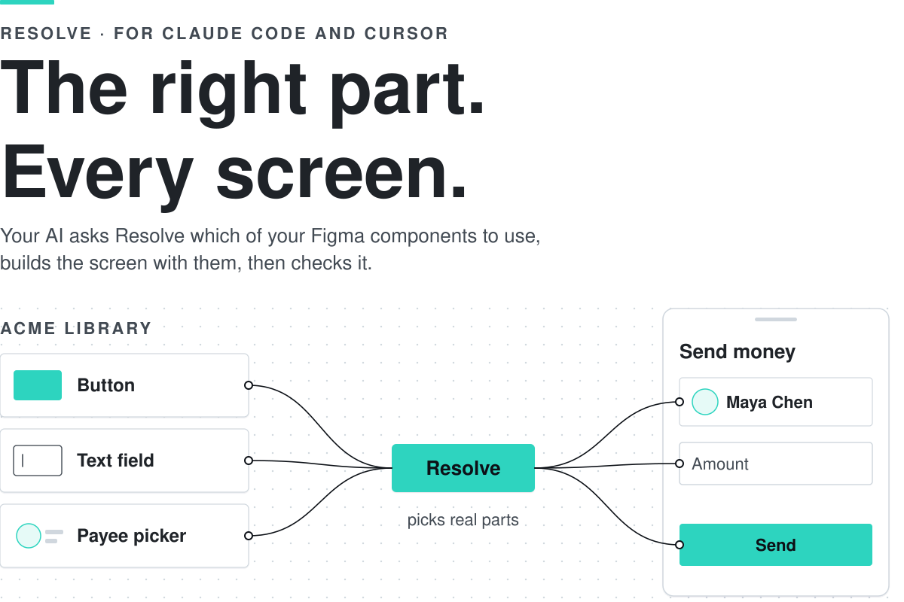
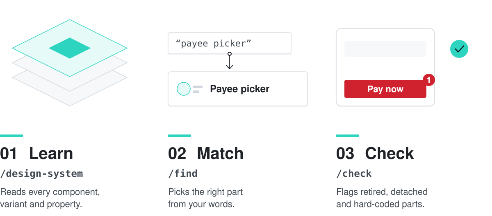
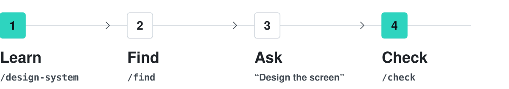
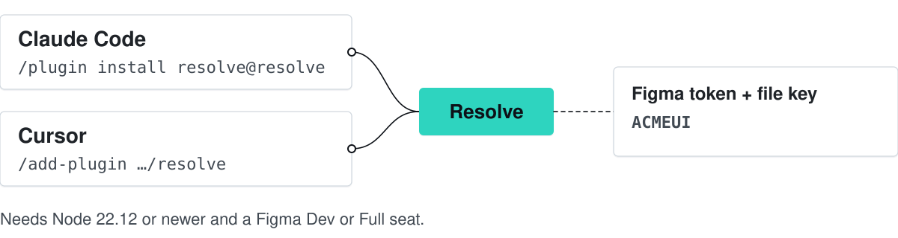
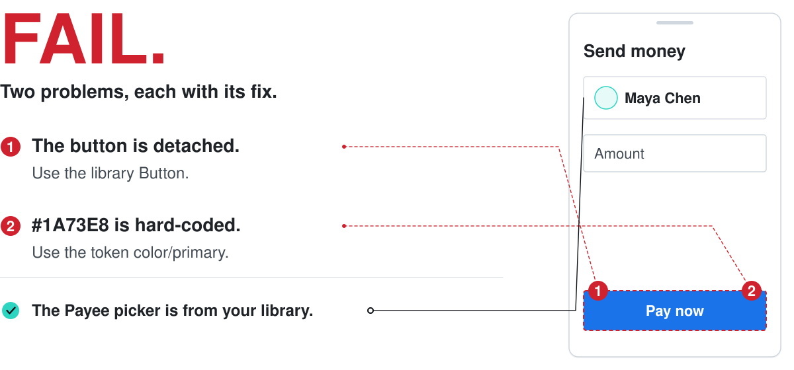
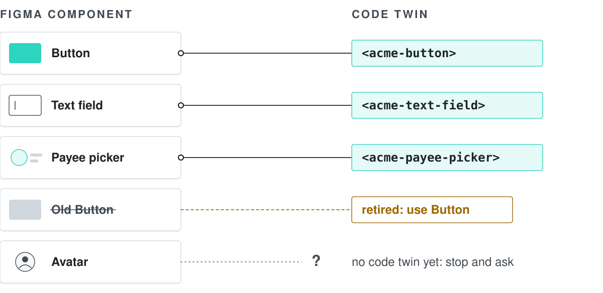
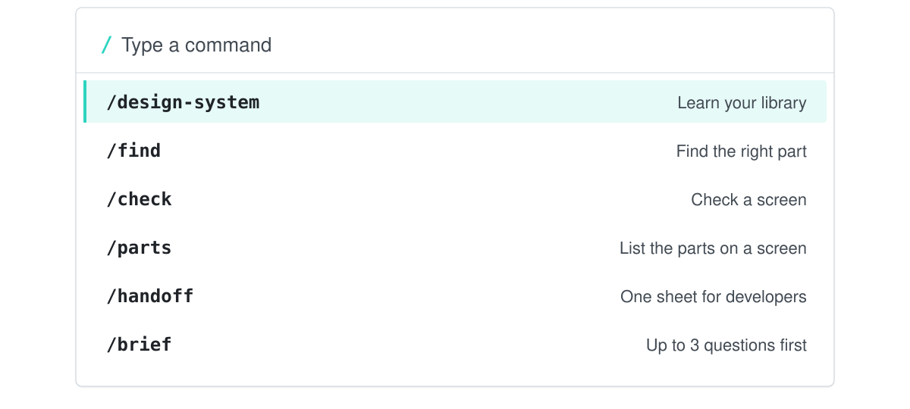

<p align="center"><picture><source media="(prefers-color-scheme: dark)" srcset="docs/assets/resolve-logo-dark.svg"></picture></p>

<picture><source media="(prefers-color-scheme: dark)" srcset="docs/assets/v4/hero-dark.svg"></picture>

<p align="center"><a href="#quick-start"><b>Quick start</b></a> · <a href="#install">Install</a> · <a href="INSTALL-FOR-AI.md">Install for AI</a> · <a href="docs/REFERENCE.md">Full reference</a></p>

<p align="center">
	<a href="https://github.com/TANISHQBAFNA/resolve/actions/workflows/ci.yml"></a>
	<a href="LICENSE"></a>
	<a href="package.json"></a>
	<a href="package.json"></a>
	<a href=".claude-plugin/plugin.json"></a>
	<a href=".cursor-plugin/plugin.json"></a>
</p>

## What it does

<picture><source media="(prefers-color-scheme: dark)" srcset="docs/assets/v4/what-dark.svg"></picture>

Resolve gives your AI two things about your design system: **what your components are** (variants, properties, real examples and code) and **how to use them** (a short always-on rule and screen recipes). Your AI asks Resolve before it draws. Resolve only reads. It never draws and never changes your Figma file.

> [!NOTE]
> The pictures use **Acme**, a made-up design system. They are illustrations, not screenshots.

## Quick start

<picture><source media="(prefers-color-scheme: dark)" srcset="docs/assets/v4/quick-dark.svg"></picture>

1. **Learn your library.** Paste the link to your design system file.

   ```
   /design-system https://www.figma.com/design/ACMEUI/Acme
   ```

   You see how many components it learned, how many are retired, and where it saved them.

2. **Find a part.** Use its name if you know it, or your own words.

   ```
   /find payee picker
   ```

   ```text
   name: Payee picker | figmaNodeId: 30:30 | fileKey: ACMEUI | why: used 4× in file | ex: 20:31
   ```

3. **Build a screen.** Ask in plain words.

   > Design the Send money screen in the Acme Payments app using Resolve.

4. **Check it.** Paste the link to that one screen.

   ```
   /check https://www.figma.com/design/ACMEUI/Acme?node-id=20-40
   ```

   ```text
   FAIL
   deprecated:
     - name: Old Button | figmaNodeId: 30:50 | fileKey: ACMEUI | status: deprecated
   ```

   The Acme Send money screen still uses the retired Old Button, so it fails. Swap it for Button and check again.

The output lines are shortened from real runs on the Acme example library.

## Install

<picture><source media="(prefers-color-scheme: dark)" srcset="docs/assets/v4/install-dark.svg"></picture>

You need Node 22.12 or newer, Claude Code or Cursor, and a Figma Dev or Full seat.

**Claude Code.** Type these two lines in the chat:

```
/plugin marketplace add TANISHQBAFNA/resolve
```

```
/plugin install resolve@resolve
```

**Cursor.** Type this in the chat, then install **resolve**:

```
/add-plugin https://github.com/TANISHQBAFNA/resolve
```

Then fill in two settings: your **Figma token** and the **library file key**. The key is the id in the file link: in `figma.com/design/ACMEUI/Acme` it is `ACMEUI`. Never put the token in a file.

**Or let your AI install it in one project.** Paste this into the chat:

> Install Resolve from https://github.com/TANISHQBAFNA/resolve — follow INSTALL-FOR-AI.md

Codex, Claude Desktop and by-hand steps: [Install in detail](docs/REFERENCE.md#install-in-detail).

## Check a screen

<picture><source media="(prefers-color-scheme: dark)" srcset="docs/assets/v4/check-dark.svg"></picture>

Every problem comes with its fix. Retired parts, detached parts, hard-coded values, wrong property values and accessibility are all checked.

## From design to code

<picture><source media="(prefers-color-scheme: dark)" srcset="docs/assets/v4/code-dark.svg"></picture>

The code map says which Figma part is which code part. Resolve can read your component package and suggest pairs. A suggestion is not the truth: someone confirms it. Only a confirmed pair shows on `/parts` and `/handoff`. If a part has no confirmed pair, stop and ask. Details: [Code map in the reference](docs/REFERENCE.md#scan-suggest-review).

## Commands

<picture><source media="(prefers-color-scheme: dark)" srcset="docs/assets/v4/commands-dark.svg"></picture>

| Type | You get |
| --- | --- |
| `/design-system <link>` | Resolve learns that Figma file and saves its components. |
| `/find <phrase>` | The right component, a weak match marked as weak, or "no match". |
| `/check <link>` | Pass, or the retired, wrong and unknown parts plus proper-use problems. |
| `/parts <link>` | Each component on the screen and its mapped code twin. Unmapped means stop and ask. |
| `/handoff <link>` | A developer build sheet for the screen. Mapped code twins only. |
| `/brief` | Asks up to 3 quick questions before Resolve picks parts. |
| `/code-map scan\|suggest\|review` | Read your component package, propose code pairs, then confirm them. |
| `/resolve-status` | What is learned, whether the token and rule are set, and what to do next. |

## Learn more

| Topic | Where |
| --- | --- |
| How it works, step by step | [How it works in detail](docs/REFERENCE.md#how-it-works-in-detail) |
| Proper-use checks | [Check that a screen uses the library properly](docs/REFERENCE.md#check-that-a-screen-uses-the-library-properly) |
| Accuracy and the phrase scoreboard | [Accuracy and honesty rules](docs/REFERENCE.md#accuracy-and-honesty-rules) |
| Every command and option | [Every command](docs/REFERENCE.md#every-command) |
| Team files (synonyms, code map) | [Team config files](docs/REFERENCE.md#team-config-files) |
| What is not tested yet | [Limits](docs/REFERENCE.md#limits-what-is-not-tested-yet) |
| Questions and words | [Questions designers ask](docs/REFERENCE.md#questions-designers-ask) · [Words used here](docs/REFERENCE.md#words-used-here) · [FAQ](docs/REFERENCE.md#faq) |
| Build Resolve yourself | [For developers](docs/REFERENCE.md#for-developers) |
| Other guides | [Designer guide](docs/GUIDE.md) · [Recipes](docs/RECIPES.md) · [How to use the parts](docs/SOCI.md) · [Scoreboard](docs/SCOREBOARD.md) · [Architecture](docs/ARCHITECTURE.md) |
| Upgrading from an older version | [Upgrading from the old names](docs/REFERENCE.md#upgrading-from-the-old-names) |
| What a component means to Resolve | [What a component means](docs/REFERENCE.md#what-a-component-means) |

**Version history → [wiki](https://github.com/TANISHQBAFNA/resolve/wiki/Version-history)**

## License

You may install and use Resolve, unchanged, inside your AI tools (Claude Code, Cursor and similar). You may not modify, copy, redistribute or build other products from it without written permission. Earlier MIT versions stay MIT for those copies. See [`LICENSE`](LICENSE).

## Upgrading from the old names

Used Resolve when it had its old name? Your old settings still work.

Older versions used the setting `GRAPHIFY_HOME` and a project folder named `.graphify/`. Both still work: if the new `RESOLVE_HOME` / `.resolve/` exist they win, otherwise the old ones are read. Nothing is moved or deleted for you. To switch, rename the whole old folder to `.resolve/` (for example `mv .graphify .resolve`) and set `RESOLVE_HOME` if you used the old setting. Do not keep both folders. Resolve reads each file from the new folder first. For some files it falls back to the old folder when the new one does not have them: `code-map.json`, `synonyms.json`, `icon-libraries.json`, and the learned library itself. A stale old file of those kinds could keep applying. The other team files (`recipes.json`, `bind-rules.json`, `context-packs.json`, `library-rules.json`) are read only from the folder that holds the learned library, so once `.resolve` has one, the old copies are ignored.
