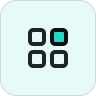
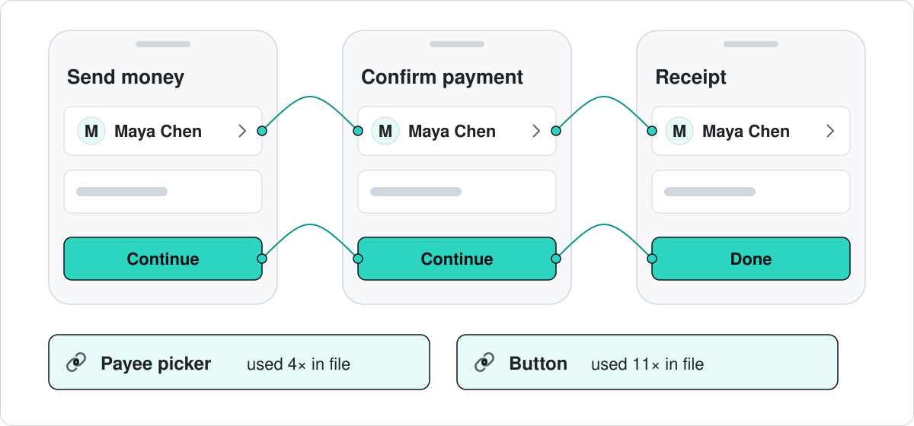
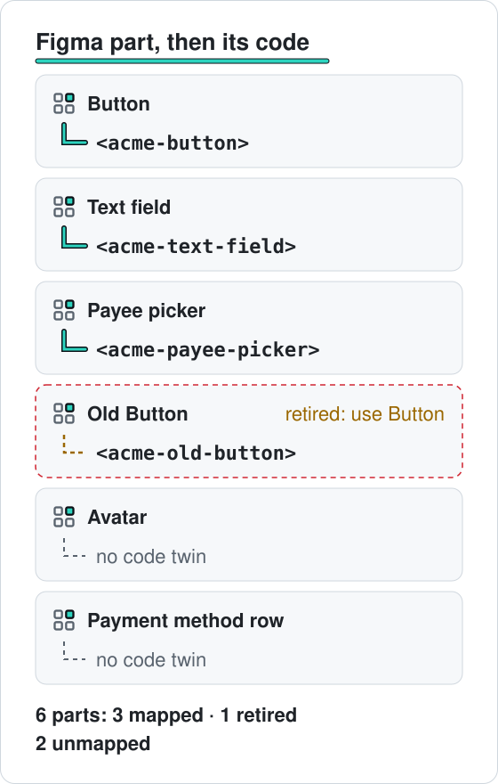

<p align="center"><picture><source media="(prefers-color-scheme: dark)" srcset="docs/assets/resolve-logo-dark.svg"></picture></p>
<h3 align="center">The right component, every time your AI designs a screen</h3>
<p align="center">Resolve tells Claude Code and Cursor which of your real Figma components to use, then checks the screen they built.</p>
<p align="center">
	<a href="#install">Install</a> ·
	<a href="#quick-start">Quick start</a> ·
	<a href="INSTALL-FOR-AI.md">Install for AI</a> ·
	<a href="docs/REFERENCE.md">Full reference</a> ·
	<a href="#version-history">Version history</a>
</p>
<p align="center">
	<a href="https://github.com/TANISHQBAFNA/resolve/actions/workflows/ci.yml"></a>
	<a href="LICENSE"></a>
	<a href="package.json"></a>
	<a href="package.json"></a>
	<a href=".claude-plugin/plugin.json"></a>
	<a href=".cursor-plugin/plugin.json"></a>
</p>

<picture><source media="(prefers-color-scheme: dark)" srcset="docs/assets/hero-dark.svg"></picture>

<p align="center">You ask in plain words. Your AI builds with your real parts.</p>

<picture><source media="(prefers-color-scheme: dark)" srcset="docs/assets/before-after-dark.svg"></picture>

<p align="center">Without Resolve the AI guesses. With Resolve the check passes.</p>

> [!NOTE]
> Every example and picture here uses **Acme**, a made-up design system. The pictures are illustrations, not screenshots.

## What Resolve is

Resolve gives your AI two things about your design system: what your components are, and how to use them. We call this an **MSOCK**: **SOCK** = what your components are (variants, properties, recipes and code), **SOCI** = how to use them (the always-on rule, recipes and context). Your AI asks Resolve before it draws. Resolve only reads. It never draws and never changes your Figma file.

## How it works

<picture><source media="(prefers-color-scheme: dark)" srcset="docs/assets/walkthrough-dark.svg"></picture>

1. **Learn.** `/design-system` reads every component, variant and property.
2. **Match.** `/find` uses known names first, then your own words.
3. **Check.** `/check` flags retired, detached and hard-coded parts.

## Features

<table>
<tr>
<td width="33%" valign="top"><picture><source media="(prefers-color-scheme: dark)" srcset="docs/assets/icon-component-dark.svg"></picture><br><b>Knows your library</b><br>Every component, variant and property, learned from your Figma file.</td>
<td width="33%" valign="top"><picture><source media="(prefers-color-scheme: dark)" srcset="docs/assets/icon-resolve-dark.svg"></picture><br><b>Known name first</b><br>A named part, like <code>Popover</code>, goes straight to that component.</td>
<td width="33%" valign="top"><picture><source media="(prefers-color-scheme: dark)" srcset="docs/assets/icon-chat-dark.svg"></picture><br><b>Speaks designer</b><br>&ldquo;payee picker&rdquo; finds Payee picker. No match means no answer.</td>
</tr>
<tr>
<td width="33%" valign="top"><picture><source media="(prefers-color-scheme: dark)" srcset="docs/assets/icon-sparkle-dark.svg"></picture><br><b>Tells the AI how</b><br>An always-on rule, screen recipes and context from your requirements.</td>
<td width="33%" valign="top"><picture><source media="(prefers-color-scheme: dark)" srcset="docs/assets/icon-check-dark.svg"></picture><br><b>Checks every screen</b><br>Retired, detached and hard-coded parts, and accessibility, with the fix.</td>
<td width="33%" valign="top"><picture><source media="(prefers-color-scheme: dark)" srcset="docs/assets/icon-code-dark.svg"></picture><br><b>Code and handoff</b><br>React or Angular code twins, and a build sheet for developers.</td>
</tr>
</table>

<picture><source media="(prefers-color-scheme: dark)" srcset="docs/assets/cross-screen-dark.svg"></picture>

<p align="center">Resolve knows where each part is really used.</p>

## A short briefing

Before it picks parts for a screen, Resolve can ask up to 3 questions. It asks only when the request fits the library and the answer would change which component it picks. It does not ask what kind of screen it is. States (empty, loading, error, pending) can take more than one answer. A request that fits nothing, including a mistyped one, gets "No match." and no questions.

If you say "just build", "go ahead and build", or "build without asking", it asks nothing. With no match, it does not invent a part.

Type `/brief show recent payments`, or let the AI call the `brief` tool. The answers change `recommend` and the parts on the handoff sheet.

## What the AI gets

<picture><source media="(prefers-color-scheme: dark)" srcset="docs/assets/component-card-dark.svg"></picture>

<p align="center">One short card per part, with a real example to copy.</p>

## Check a screen

<picture><source media="(prefers-color-scheme: dark)" srcset="docs/assets/check-result-dark.svg"></picture>

<p align="center">Every problem comes with its fix.</p>

## From design to code

<picture><source media="(prefers-color-scheme: dark)" srcset="docs/assets/code-map-dark.svg"></picture>

<p align="center">Each Figma part links to its code twin.</p>

`/parts` shows which parts have code and which do not. `/handoff` turns a screen into a build sheet for developers.

## Install

You need Node 22.12 or newer, Claude Code or Cursor, and a Figma Dev or Full seat.

**Claude Code.** Type these two lines in the chat:

```
/plugin marketplace add TANISHQBAFNA/resolve
```

```
/plugin install resolve@resolve
```

**Cursor.** Type this in the chat, then install **resolve**:

```
/add-plugin https://github.com/TANISHQBAFNA/resolve
```

Then fill in two settings: your **Figma token** and the **library file key**. The key is the id in the file link: in `figma.com/design/ACMEUI/Acme` it is `ACMEUI`. Never put the token in a file.

**Or let your AI install it in one project.** Paste this into the chat:

> Install Resolve from https://github.com/TANISHQBAFNA/resolve — follow INSTALL-FOR-AI.md

Codex, Claude Desktop and by-hand steps: [Install in detail](docs/REFERENCE.md#install-in-detail).

## Quick start

1. **Learn your library.** Paste the link to your design system file.

   ```
   /design-system https://www.figma.com/design/ACMEUI/Acme
   ```

   You see how many components it learned, how many are retired, and where it saved them.

2. **Find a part.** Use its name if you know it, or your own words.

   ```
   /find payee picker
   ```

   ```text
   name: Payee picker | figmaNodeId: 30:30 | fileKey: ACMEUI | why: used 4× in file | ex: 20:31
   ```

3. **Build a screen.** Ask in plain words.

   > Design the Send money screen in the Acme Payments app using Resolve.

4. **Check it.** Paste the link to that one screen.

   ```
   /check https://www.figma.com/design/ACMEUI/Acme?node-id=20-40
   ```

   ```text
   FAIL
   deprecated:
     - name: Old Button | figmaNodeId: 30:50 | fileKey: ACMEUI | status: deprecated
   ```

   The Acme Send money screen still uses the retired Old Button, so it fails. Swap it for Button and check again.

The output lines are shortened from real runs on the Acme example library.

## Slash commands

| Type | You get |
| --- | --- |
| `/design-system <link>` | Resolve learns that Figma file and saves its components. |
| `/find <phrase>` | The right component, a weak match marked as weak, or "no match". |
| `/check <link>` | Pass, or the retired, wrong and unknown parts plus proper-use problems. |
| `/parts <link>` | Each component on the screen and its mapped code twin. Unmapped means stop and ask. |
| `/handoff <link>` | A developer build sheet for the screen. Mapped code twins only. |
| `/code-map scan\|suggest\|review` | Read an Angular package, propose code pairs, then confirm them. |
| `/resolve-status` | What is learned, whether the token and rule are set, and what to do next. |

## Code map

The code map is the list of which Figma part is which code part. Resolve can read an Acme Angular package and suggest pairs from the names and from Figma properties to inputs. A suggestion is not the truth. Someone confirms it. Only a confirmed pair shows on `/parts` and `/handoff`. If a part has no confirmed pair, stop and ask.

| Figma | Code | What you do |
| --- | --- | --- |
| Button | `AcmeButtonComponent` | Mapped. Use it. |
| Text field | a suggestion | Not used until you confirm it. |
| Avatar | — | Unmapped. Stop and ask. |

A part can map to more than one code component, and one code component can map to more than one part. "Composed of" is a link too: Payee picker is the picker, and it contains the text field. When the Figma library version or the package version changes, those rows are flagged for another look. The detail, and the measured suggestion score on the made-up Acme package (precision 1, recall 1, 9 of 9, no wrong mapped link), is in [the code map reference](docs/REFERENCE.md#scan-suggest-review).

More detail: [Slash commands in detail](docs/REFERENCE.md#slash-commands-in-detail).

## Learn more

| Topic | Where |
| --- | --- |
| How it works, step by step | [How it works in detail](docs/REFERENCE.md#how-it-works-in-detail) |
| Proper-use checks | [Check that a screen uses the library properly](docs/REFERENCE.md#check-that-a-screen-uses-the-library-properly) |
| Accuracy and the phrase scoreboard | [Accuracy and honesty rules](docs/REFERENCE.md#accuracy-and-honesty-rules) |
| Every command and option | [Every command](docs/REFERENCE.md#every-command) |
| Team files (synonyms, code map) | [Team config files](docs/REFERENCE.md#team-config-files) |
| What is not tested yet | [Limits](docs/REFERENCE.md#limits-what-is-not-tested-yet) |
| Questions and words | [Questions designers ask](docs/REFERENCE.md#questions-designers-ask) · [Words used here](docs/REFERENCE.md#words-used-here) · [FAQ](docs/REFERENCE.md#faq) |
| Build Resolve yourself | [For developers](docs/REFERENCE.md#for-developers) |
| Other guides | [Designer guide](docs/GUIDE.md) · [Recipes](docs/RECIPES.md) · [SOCI](docs/SOCI.md) · [Scoreboard](docs/SCOREBOARD.md) · [Architecture](docs/ARCHITECTURE.md) |

### Upgrading from the old names

Used Resolve when it had its old name? Your old settings still work.

<details>
<summary>Read the upgrade note</summary>

Older versions used the setting `GRAPHIFY_HOME` and a project folder named `.graphify/`. Both still work: if the new `RESOLVE_HOME` / `.resolve/` exist they win, otherwise the old ones are read. Nothing is moved or deleted for you. To switch, rename the whole old folder to `.resolve/` (for example `mv .graphify .resolve`) and set `RESOLVE_HOME` if you used the old setting. Do not keep both folders. Resolve reads each file from the new folder first. For some files it falls back to the old folder when the new one does not have them: `code-map.json`, `synonyms.json`, `icon-libraries.json`, and the learned library itself. A stale old file of those kinds could keep applying. The other team files (`recipes.json`, `bind-rules.json`, `context-packs.json`, `library-rules.json`) are read only from the folder that holds the learned library, so once `.resolve` has one, the old copies are ignored.

</details>

## Version history

Newest first. The full list is in the [reference](docs/REFERENCE.md#version-history).

- **Oct 20, 2026 — [PR #69](https://github.com/TANISHQBAFNA/resolve/pull/69).** When no saved recipe fits, `recipe --compose` (MCP `compose: true`, advanced only) builds one from the parts you name, each filled by `recommend`. It never invents a part; a part with no fit says No match. Fewer than 2 fitting parts is not a recipe. Nothing is saved until a person approves the `--propose` proposal. Fresh set: held-out slot precision 28/31, recall 28/32, invented 0. Round 1: a part whose last word does not match is marked weak, not a fit; parts after place words are kept and every no-fit part is listed; a saved recipe with the same title or parts is named as a warning and not proposed; the proposal id includes the parts and a decided proposal is refused; approve refuses private parts, variants, non-components, empty or duplicate recipes; empty input is an error. Held-out unchanged: precision 28/31, recall 28/32. Round 2: `brief` offers to compose when no saved recipe fits and two or more parts are named (offer only); briefing answers fill composed slots with their real parts; container words (list, group, set) are not the part word, so a radio list fits Radio. Round 3: a part fits only when every main word is in its name, a variant name or a synonym, otherwise weak, check; approve needs 2 or more parts; on/in phrases are context, not parts; a set of X takes X; brief says savedRecipe when compose would warn. Held-out 27/30 precision, 27/32 recall, invented 0. Round 4: words after on/in/inside are a part when they fit a library part (a row inside a modal), else context; device, theme and density words stay context; all-weak results say weak, not No match. Default MCP tools unchanged. Phrase score unchanged.
- **Oct 20, 2026 — [PR #67](https://github.com/TANISHQBAFNA/resolve/pull/67).** Before picking parts for a screen, Resolve asks at most 3 multiple-choice questions, and only when the request fits and the answer would change the component. No screen-type question. States can take more than one answer. No match asks nothing and invents nothing. Answers change the handoff parts. Round 2: the fit check uses recommend's own ranking, so plurals and close phrasing fit. A nav with no platform asks desktop or mobile. States are asked for any real part, except a nav, when the request names none. A fresh 41-request held-out set: question recall 10/12, question precision 10/15, 0.41 questions per request (max 2), part recall 28/30, part precision 1. Round 3: a request that names a part plus a context ("summary cards for the order") is not asked states. A state option is offered only when it adds a part the request does not already have. A list ask with no shape named asks one question: list or table. Held-out set now 49 requests: question recall 7/9, precision 7/8, 0.16 questions per request (max 1), part recall 36/38. Round 4: the list-or-table question is asked only when recommend finds a part from the request's other words; "all", "every" or "list of" with an off-topic or misspelt noun says No match and asks nothing. Held-out (54): question recall 4/6, precision 4/5, 0.09 questions per request. Phrase score unchanged.
- **Oct 20, 2026 — [PR #65](https://github.com/TANISHQBAFNA/resolve/pull/65).** New README pictures: real screens instead of boxes, two short animations that play once, a full code map and new icons. Text in the pictures shows at 22px or more on GitHub. A "From design to code" section comes before Install.
- **Oct 20, 2026 — [PR #64](https://github.com/TANISHQBAFNA/resolve/pull/64).** The README pictures, logo and badge use a brighter teal. In light mode, words are near-black and the teal is in fills, chips and underlines. PASS stays green.
- **Oct 20, 2026 — [PR #63](https://github.com/TANISHQBAFNA/resolve/pull/63).** `resolve code-map scan` reads a made-up Acme Angular package. `suggest` proposes Figma-to-code pairs and never treats them as truth. `review` confirms them through the CSV. Only a mapped pair shows on `/parts` and `/handoff`. An unmapped part means stop and ask. On the Acme edge fixture, suggested pairs score precision 1 and recall 43/49, and partial pairs score precision 5/6 and recall 5/49. Accepting every suggestion makes 0 wrong mapped links. Phrase score unchanged: top-1 83/88, top-3 85/88. 928 tests.
- **Oct 20, 2026 — [PR #61](https://github.com/TANISHQBAFNA/resolve/pull/61).** A failed check now says `pass: false` in JSON, including when proper use fails. Status still prints local time with a zone name, and the tests accept that. Tests stop with one clear message on Node older than 22.12. CI fails if the phrase score drops below 83 of 88 first picks or 85 of 88 in the top 3. CI runs on Node 22 and 24, in UTC and India time, and the browser checks include Firefox.
- **Oct 20, 2026 — [PR #62](https://github.com/TANISHQBAFNA/resolve/pull/62).** The README pictures, logo and badge changed from purple to teal. PASS stays green.
- **Oct 19, 2026 — [PR #60](https://github.com/TANISHQBAFNA/resolve/pull/60).** This visual README. The full manual moved to `docs/REFERENCE.md`.
- **Oct 13, 2026 — [PR #58](https://github.com/TANISHQBAFNA/resolve/pull/58).** `resolve learn` reads JSON files. A preferred library wins between parts with the same name. Slot properties are kept.
- **Oct 13, 2026 — [PR #48](https://github.com/TANISHQBAFNA/resolve/pull/48).** Re-learning a page replaces it. Slots and hidden layers are handled.
- **Oct 13, 2026 — [PR #57](https://github.com/TANISHQBAFNA/resolve/pull/57).** `/check` also checks proper use: detached parts, hard-coded values, wrong property values and accessibility.
- **Oct 12, 2026 — [PR #56](https://github.com/TANISHQBAFNA/resolve/pull/56).** The phrase finder's top-3 rose from 68/88 to 85/88.
- **Oct 11, 2026 — [PR #50](https://github.com/TANISHQBAFNA/resolve/pull/50).** Resolve installs once as a Claude Code and Cursor plugin.

## License

MIT. See [`LICENSE`](LICENSE).
