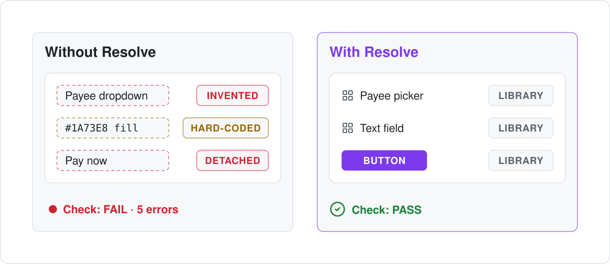
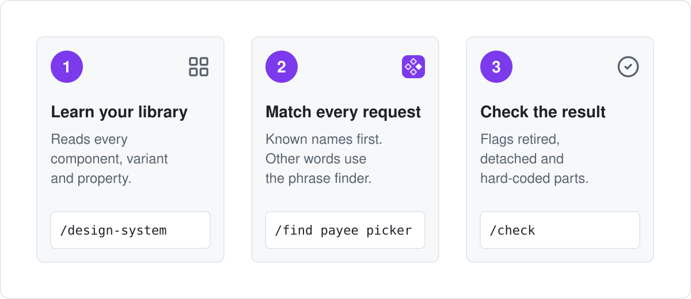
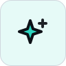
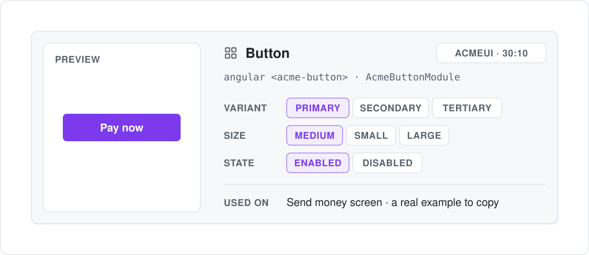
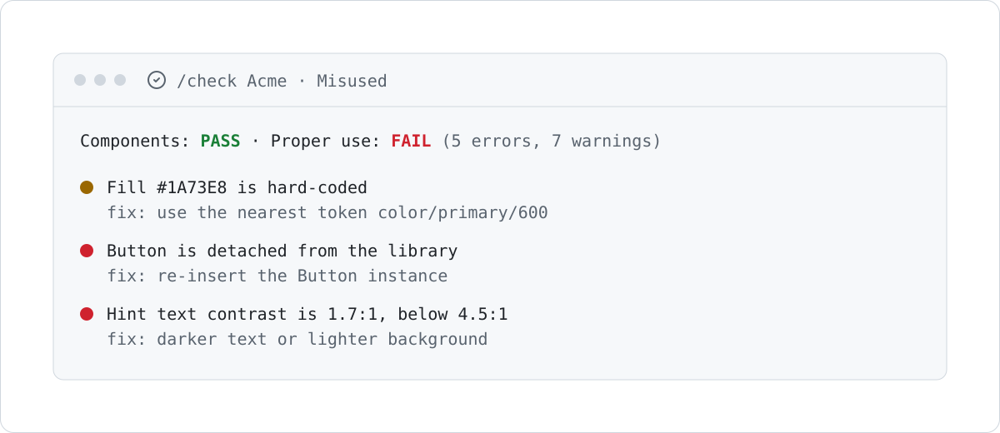

<p align="center"><picture><source media="(prefers-color-scheme: dark)" srcset="docs/assets/resolve-logo-dark.svg"></picture></p>
<h3 align="center">The right component, every time your AI designs a screen</h3>
<p align="center">Resolve tells Claude Code and Cursor which of your real Figma components to use, then checks the screen they built.</p>
<p align="center">
	<a href="#install">Install</a> ·
	<a href="#quick-start">Quick start</a> ·
	<a href="INSTALL-FOR-AI.md">Install for AI</a> ·
	<a href="docs/REFERENCE.md">Full reference</a> ·
	<a href="#version-history">Version history</a>
</p>
<p align="center">
	<a href="https://github.com/TANISHQBAFNA/resolve/actions/workflows/ci.yml"></a>
	<a href="LICENSE"></a>
	<a href="package.json"></a>
	<a href="package.json"></a>
	<a href=".claude-plugin/plugin.json"></a>
	<a href=".cursor-plugin/plugin.json"></a>
</p>

<picture><source media="(prefers-color-scheme: dark)" srcset="docs/assets/hero-dark.svg"></picture>

<p align="center">You ask in plain words, and your AI builds with your real parts.</p>

<picture><source media="(prefers-color-scheme: dark)" srcset="docs/assets/before-after-dark.svg"></picture>

<p align="center">Without Resolve the AI guesses. With Resolve the check passes.</p>

> [!NOTE]
> Every example and picture here uses **Acme**, a made-up design system. The pictures are illustrations, not screenshots.

## What Resolve is

Resolve gives your AI two things about your design system: what your components are, and how to use them. We call this an **MSOCK**: **SOCK** = what your components are (variants, properties, recipes and code), **SOCI** = how to use them (the always-on rule, recipes and context). Your AI asks Resolve before it draws. Resolve only reads. It never draws and never changes your Figma file.

## How it works

<picture><source media="(prefers-color-scheme: dark)" srcset="docs/assets/how-it-works-dark.svg"></picture>

## Features

<table>
<tr>
<td width="33%" valign="top"><picture><source media="(prefers-color-scheme: dark)" srcset="docs/assets/icon-grid-dark.svg"></picture><br><b>Knows your library</b><br>Every component, variant and property, learned from your Figma file.</td>
<td width="33%" valign="top"><picture><source media="(prefers-color-scheme: dark)" srcset="docs/assets/icon-logo-dark.svg"></picture><br><b>Known name first</b><br>A named part, like <code>Popover</code>, goes straight to that component.</td>
<td width="33%" valign="top"><picture><source media="(prefers-color-scheme: dark)" srcset="docs/assets/icon-chat-dark.svg"></picture><br><b>Speaks designer</b><br>&ldquo;payee picker&rdquo; finds Payee picker. No match means no answer.</td>
</tr>
<tr>
<td width="33%" valign="top"><picture><source media="(prefers-color-scheme: dark)" srcset="docs/assets/icon-sparkle-dark.svg"></picture><br><b>Tells the AI how</b><br>An always-on rule, screen recipes and context from your requirements.</td>
<td width="33%" valign="top"><picture><source media="(prefers-color-scheme: dark)" srcset="docs/assets/icon-check-dark.svg"></picture><br><b>Checks every screen</b><br>Retired, detached and hard-coded parts, and accessibility, with the fix.</td>
<td width="33%" valign="top"><picture><source media="(prefers-color-scheme: dark)" srcset="docs/assets/icon-code-dark.svg"></picture><br><b>Code and handoff</b><br>React or Angular code twins, and a build sheet for developers.</td>
</tr>
</table>

## What the AI gets

<picture><source media="(prefers-color-scheme: dark)" srcset="docs/assets/component-card-dark.svg"></picture>

<p align="center">One short card per part, with the values it allows and a real example.</p>

## Check a screen

<picture><source media="(prefers-color-scheme: dark)" srcset="docs/assets/check-result-dark.svg"></picture>

<p align="center">Every problem comes with its fix.</p>

## Install

You need Node 22.12 or newer, Claude Code or Cursor, and a Figma Dev or Full seat.

**Claude Code.** Type these two lines in the chat:

```
/plugin marketplace add TANISHQBAFNA/resolve
```

```
/plugin install resolve@resolve
```

**Cursor.** Type this in the chat, then install **resolve**:

```
/add-plugin https://github.com/TANISHQBAFNA/resolve
```

Then fill in two settings: your **Figma token** and the **library file key**. The key is the id in the file link: in `figma.com/design/ACMEUI/Acme` it is `ACMEUI`. Never put the token in a file.

**Or let your AI install it in one project.** Paste this into the chat:

> Install Resolve from https://github.com/TANISHQBAFNA/resolve — follow INSTALL-FOR-AI.md

Codex, Claude Desktop and by-hand steps: [Install in detail](docs/REFERENCE.md#install-in-detail).

## Quick start

1. **Learn your library.** Paste the link to your design system file.

   ```
   /design-system https://www.figma.com/design/ACMEUI/Acme
   ```

   You see how many components it learned, how many are retired, and where it saved them.

2. **Find a part.** Use its name if you know it, or your own words.

   ```
   /find payee picker
   ```

   ```text
   name: Payee picker | figmaNodeId: 30:30 | fileKey: ACMEUI | why: used 4× in file | ex: 20:31
   ```

3. **Build a screen.** Ask in plain words.

   > Design the Send money screen in the Acme Payments app using Resolve.

4. **Check it.** Paste the link to that one screen.

   ```
   /check https://www.figma.com/design/ACMEUI/Acme?node-id=20-40
   ```

   ```text
   FAIL
   deprecated:
     - name: Old Button | figmaNodeId: 30:50 | fileKey: ACMEUI | status: deprecated
   ```

   The Acme Send money screen still uses the retired Old Button, so it fails. Swap it for Button and check again.

The output lines are shortened from real runs on the Acme example library.

## Slash commands

| Type | You get |
| --- | --- |
| `/design-system <link>` | Resolve learns that Figma file and saves its components. |
| `/find <phrase>` | The right component, a weak match marked as weak, or "no match". |
| `/check <link>` | Pass, or the retired, wrong and unknown parts plus proper-use problems. |
| `/parts <link>` | Each component on the screen and its code twin. |
| `/handoff <link>` | A developer build sheet for the screen. |
| `/resolve-status` | What is learned, whether the token and rule are set, and what to do next. |

More detail: [Slash commands in detail](docs/REFERENCE.md#slash-commands-in-detail).

## Learn more

| Topic | Where |
| --- | --- |
| How it works, step by step | [How it works in detail](docs/REFERENCE.md#how-it-works-in-detail) |
| Proper-use checks | [Check that a screen uses the library properly](docs/REFERENCE.md#check-that-a-screen-uses-the-library-properly) |
| Accuracy and the phrase scoreboard | [Accuracy and honesty rules](docs/REFERENCE.md#accuracy-and-honesty-rules) |
| Every command and option | [Every command](docs/REFERENCE.md#every-command) |
| Team files (synonyms, code map) | [Team config files](docs/REFERENCE.md#team-config-files) |
| What is not tested yet | [Limits](docs/REFERENCE.md#limits-what-is-not-tested-yet) |
| Questions and words | [Questions designers ask](docs/REFERENCE.md#questions-designers-ask) · [Words used here](docs/REFERENCE.md#words-used-here) · [FAQ](docs/REFERENCE.md#faq) |
| Build Resolve yourself | [For developers](docs/REFERENCE.md#for-developers) |
| Other guides | [Designer guide](docs/GUIDE.md) · [Recipes](docs/RECIPES.md) · [SOCI](docs/SOCI.md) · [Scoreboard](docs/SCOREBOARD.md) · [Architecture](docs/ARCHITECTURE.md) |

### Upgrading from the old names

Used Resolve when it had its old name? Your old settings still work.

<details>
<summary>Read the upgrade note</summary>

Older versions used the setting `GRAPHIFY_HOME` and a project folder named `.graphify/`. Both still work: if the new `RESOLVE_HOME` / `.resolve/` exist they win, otherwise the old ones are read. Nothing is moved or deleted for you. To switch, rename the whole old folder to `.resolve/` (for example `mv .graphify .resolve`) and set `RESOLVE_HOME` if you used the old setting. Do not keep both folders. Resolve reads each file from the new folder first. For some files it falls back to the old folder when the new one does not have them: `code-map.json`, `synonyms.json`, `icon-libraries.json`, and the learned library itself. A stale old file of those kinds could keep applying. The other team files (`recipes.json`, `bind-rules.json`, `context-packs.json`, `library-rules.json`) are read only from the folder that holds the learned library, so once `.resolve` has one, the old copies are ignored.

</details>

## Version history

Newest first. The full list is in the [reference](docs/REFERENCE.md#version-history).

- **Oct 20, 2026 — brighter teal.** The README pictures, logo and badge use a brighter teal. In light mode, words are near-black and the teal is in fills, chips and underlines. PASS stays green.
- **Oct 20, 2026 — [PR #61](https://github.com/TANISHQBAFNA/resolve/pull/61).** A failed check now says `pass: false` in JSON, including when proper use fails. Status still prints local time with a zone name, and the tests accept that. Tests stop with one clear message on Node older than 22.12. CI fails if the phrase score drops below 83 of 88 first picks or 85 of 88 in the top 3. CI runs on Node 22 and 24, in UTC and India time, and the browser checks include Firefox.
- **Oct 20, 2026 — [PR #62](https://github.com/TANISHQBAFNA/resolve/pull/62).** The README pictures, logo and badge changed from purple to teal. PASS stays green.
- **Oct 19, 2026 — [PR #60](https://github.com/TANISHQBAFNA/resolve/pull/60).** This visual README. The full manual moved to `docs/REFERENCE.md`.
- **Oct 13, 2026 — [PR #58](https://github.com/TANISHQBAFNA/resolve/pull/58).** `resolve learn` reads JSON files. A preferred library wins between parts with the same name. Slot properties are kept.
- **Oct 13, 2026 — [PR #48](https://github.com/TANISHQBAFNA/resolve/pull/48).** Re-learning a page replaces it. Slots and hidden layers are handled.
- **Oct 13, 2026 — [PR #57](https://github.com/TANISHQBAFNA/resolve/pull/57).** `/check` also checks proper use: detached parts, hard-coded values, wrong property values and accessibility.
- **Oct 12, 2026 — [PR #56](https://github.com/TANISHQBAFNA/resolve/pull/56).** The phrase finder's top-3 rose from 68/88 to 85/88.
- **Oct 11, 2026 — [PR #50](https://github.com/TANISHQBAFNA/resolve/pull/50).** Resolve installs once as a Claude Code and Cursor plugin.

## License

MIT. See [`LICENSE`](LICENSE).
